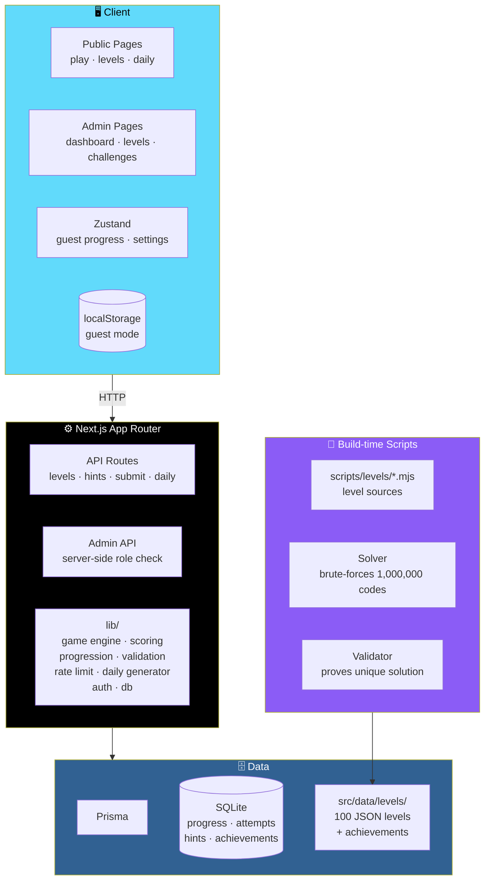

# 🔐 The Six-Digit Cipher: 100 Levels of IQ

<div align="center">


**A full-stack puzzle game — 100 hand-authored levels in five chapters.**

*Every door is guarded by a six-digit passcode hidden inside a reasoning puzzle.*

[🚀 Install](#-install-and-run) • [🎯 The 100 Levels](#-the-100-levels) • [⭐ Scoring](#-scoring) • [🏗️ Architecture](#-architecture) • [🔒 Security](#-security-and-answer-protection)

</div>

---

## 📖 Overview

**The Six-Digit Cipher** is a **full-stack puzzle game**.

You are trapped in a digital vault. Every door is guarded by a **six-digit passcode** hidden inside a reasoning puzzle.

**100 original, hand-authored levels in five chapters** — each with:

- ✅ A **verified unique answer**
- ✅ A **written solution**
- ✅ **Three progressive hints**

### 🛠️ Stack

| Layer | Technology |
|-------|-----------|
| **Framework** | Next.js 15 *(App Router)* |
| **UI** | React 19 · Tailwind CSS 3 · Framer Motion · Lucide |
| **Language** | TypeScript |
| **Validation** | Zod |
| **State** | Zustand |
| **Database** | Prisma + SQLite |
| **Testing** | Vitest · Playwright |

### ⚠️ Honest Status Note

> **This project was written and its game logic verified in an offline sandbox with no package registry access.**

### ✅ What Was Executed There

- The **full level validator** — **all 100 levels proven to have exactly one solution**
- The **daily-challenge generator**
- **Scoring / progression / engine tests**
- A **full Level 1–100 engine playthrough**
- A **strict TypeScript check** of the pure-logic modules
- The **SQL migration against SQLite**

### ⚠️ What Was NOT Possible There

- ❌ `npm install`
- ❌ `next build`
- ❌ Prisma client generation
- ❌ Vitest and Playwright runs

> 💡 **Run `npm install && npm run typecheck && npm test && npm run build` first.**
>
> **If the compiler reports a small typing nit in the UI or API layer, it will point at the exact line.**

---

## 🚀 Install and Run

### Prerequisites

- **Node.js 20.9+** *(22 LTS recommended)* and **npm 10+**
- Windows, macOS, or Linux
- **No external services** — the game works offline once installed

### 🪟 Windows *(PowerShell)*

```powershell
cd six-digit-cipher
npm install
Copy-Item .env.example .env
node -e "console.log(require('crypto').randomBytes(48).toString('hex'))"   # paste into AUTH_SECRET in .env (repeat for DAILY_SALT)
npx prisma generate
npx prisma migrate deploy
npm run db:seed
npm run dev
```

### 🍎🐧 macOS / Linux

```bash
cd six-digit-cipher
npm install
cp .env.example .env
node -e "console.log(require('crypto').randomBytes(48).toString('hex'))"   # paste into AUTH_SECRET in .env (repeat for DAILY_SALT)
npx prisma generate && npx prisma migrate deploy && npm run db:seed
npm run dev
```

**Open http://localhost:3000.**

> 💡 **Shortcut for the three DB steps:** `npm run setup`

### 👑 First Administrator

```bash
npm run admin:create
```

**Asks for an email, display name, and a password *(12+ characters)*** — and creates or promotes that user.

> ⚠️ **No default credentials exist anywhere.**
>
> **Sign in at `/admin/login`.**

### 🔄 Reset Local Data

```bash
npm run db:reset
```

**Drops, re-migrates, and re-seeds.**

**Or** delete `prisma/dev.db*` and run the three DB commands again.

---

## 🎯 The 100 Levels

<div align="center">

| Chapter | Levels | Difficulty | Mechanics |
|:-------:|:------:|-----------|-----------|
| **1 — Initiation** | 1–20 | Beginner → Intermediate | Sequences · counting · riddles · digit sums · palindromes · magic grids · word problems |
| **2 — The Analyst** | 21–40 | Intermediate | Primes · reversals · modular arithmetic · calendars · clocks · letter codes · conditionals · ordering · Latin squares |
| **3 — The Deceiver** | 41–60 | Advanced | Red herrings · cryptograms · base conversion · truth-tellers and liars · symbol substitution · sudoku · code-breaking deduction |
| **4 — The Mind Labyrinth** | 61–80 | Expert | Boolean logic · multi-stage decoding · invariants · spatial reasoning · CRT · Gray code · self-reference · optimisation · game theory |
| **5 — The Final Cipher** | 81–100 | Master | Layered ciphers · cross-referenced clues · multi-panel visuals · hidden rules · alphametics · knowledge logic · **a four-chamber finale** |

</div>

### 🔒 How the Answers Are Guaranteed Correct

> **No answer was typed by hand.**

**Each clue exists in two forms:**

1. **The text the player reads**
2. **A formal predicate**

**The solver brute-forces all 1,000,000 codes against every predicate** — and **a level is only built if exactly one code survives**.

> ✅ **That code becomes the answer.**
>
> **Level explanations are built from the same computed values.**

`npm run validate` **repeats the proof** and **compares it with the JSON in `src/data/levels/`**.

### 🎭 Red Herrings Are Fair

**Levels 41, 60, and others contain red herrings.**

**They are always:**

- **Labelled `[UNVERIFIED]`** in the clue text
- **Shown struck through**
- **Explained in the instructions** — *"ignore these"*

> ✅ **So they are fair.**

### ✏️ Editing the Campaign

1. **Change a level** in `scripts/levels/chN.mjs`
2. **Run** `npm run levels:build`
3. **Then** `npm run validate`
4. **Then re-seed** *(or use the admin dashboard on a live database)*

---

## ⭐ Scoring

<div align="center">

| Stars | Requirement |
|:-----:|-------------|
| **★★★** | **No hints** and solved **within the level's target time** |
| **★★** | **Some hints used** *(fewer than 3)* or **target time exceeded** |
| **★** | **All 3 hints used** |

</div>

> 💡 **The optional "reveal answer" feature is deliberately NOT implemented** — **hint 3 is a near-solution that still lets you enter the code yourself.**

### 💯 Points

```
1000
  − 150 per hint
  − 20 per wrong attempt
  − 1 per 3 seconds over target
  ≥ 100
```

> ✅ **Replays never lower your best.**
>
> **Hints are revealed strictly in order — the server enforces this for signed-in players.**

---

## 🏗️ Architecture

### System Overview



### 🗂️ Folder Layout

```
six-digit-cipher/
├── prisma/            schema · hand-checked initial migration · seed
├── scripts/           level sources + solver · validator
│                      variant generator · importer · admin creator
├── src/
│   ├── app/           pages (public, admin) and API routes
│   ├── components/    layout · game · levels · achievements
│   │                  admin · ui
│   ├── lib/           game engine · scoring · progression
│   │                  validation · rate limit · daily generator
│   │                  auth · db
│   ├── data/          the 100 levels (JSON) and achievements
│   ├── store/         Zustand store (guest progress cache, settings)
│   └── tests/         unit · integration · e2e
└── run.txt            short troubleshooting list
```

### Design Principles

<div align="center">

| Principle | Implementation |
|-----------|---------------|
| **🔢 Codes are strings everywhere** | UI, API, and database — so `004281` **never becomes `4281`** |
| **👤 Guest play works** | Progress, notes, and settings cached in `localStorage` — no account required |
| **🔐 Accounts are optional** | Progress, attempts, hints, and achievements stored in SQLite — the **server enforces** unlocks and hint order |
| **🧮 Levels are data** | 100 JSON files with solver-verified unique answers |
| **🚫 No hand-typed answers** | Every answer is **the one code that survives brute-force against the formal predicate** |
| **🛡️ Server-side validation** | Zod on every request — **the client never decides** |
| **🙈 Guesses aren't logged** | `LevelAttempt` stores **only correct/incorrect and time** — never the submitted code |
| **📊 SQLite with string enums** | No native enums or JSON columns — enum-like fields are validated strings, structured data is JSON text |
| **⚠️ Honest about guest mode** | Guest progress is editable — **only accounts are cheat-resistant** |

</div>

---

## 🔒 Security and Answer Protection

<div align="center">

| Protection | Implementation |
|-----------|---------------|
| **🙈 Answers never reach the browser** | The play page and `/api/levels/[n]` return a **sanitised public level**. **Hints come one at a time** from `/api/hints`. **The explanation is returned only with a correct submission** |
| **🛡️ Server-side validation** | **All validation happens on the server** *(Zod)* |
| **🚫 No leakage on failure** | Wrong answers return a **generic message** that **never contains code details** |
| **⏱️ Rate limiting** | Answer submissions are rate-limited *(burst + hourly)* per user or IP. Login, registration, hints, and admin routes have their own limits |
| **⚠️ In-memory limiter** | **Use a shared store (Redis) if you run multiple server instances** |
| **🔑 Passwords** | **bcrypt, cost 12** |
| **🍪 Sessions** | Signed JWT in an `httpOnly`, `SameSite=Lax`, `Secure` *(in production)* cookie |
| **🛡️ CSRF** | State-changing routes also check the `Origin` header |
| **👑 Admin authorization** | Every admin API route and `/admin` page **re-checks the admin role on the server per request** — the role is **re-read from the database, not trusted from the token** |
| **🔒 Headers** | Security headers set in `next.config.ts` |
| **🔐 Secrets stay server-only** | No `NEXT_PUBLIC_` secrets |

</div>

### ⚠️ Known Limitation — Guest Mode

> **Guest progress lives in the browser.**
>
> **A determined player can edit local storage to unlock levels or fake hint/attempt counts.**
>
> **Answers still cannot be read from the client.**
>
> **For cheat-resistant progress, use accounts.**
>
> **A fully offline build would have to ship answers to the browser** — **and would not be cheat-resistant at all**.

### 🛡️ Before Going Public

> **Add a Content-Security-Policy suited to your hosting.**
>
> **Next.js inline scripts need a nonce-based policy.**

---

## 👑 Admin Dashboard

**Routes:**

- `/admin/dashboard`
- `/admin/levels`
- `/admin/levels/new`
- `/admin/levels/[id]`
- `/admin/challenges`

### What You Can Do

<div align="center">

| Action | Details |
|--------|---------|
| **📝 Edit levels** | Create, edit, publish, archive *(**never hard-delete**)*, and reorder |
| **✏️ Edit content** | Titles, clues, hints, solutions, difficulty |
| **🔑 Define answers** | — |
| **👁️ Preview** | The player view |
| **📦 Import / export** | JSON |
| **📊 Analytics** | Completion rates and average attempts |
| **📅 Daily challenges** | Manage them |
| **📜 History** | Per-level change history |

</div>

### ⚠️ What Admin Validation Checks

- **Structure**
- **Leaks**
- **The level's test cases**

> ⚠️ **Proof of unique solvability is only produced for the authored campaign** *(`npm run validate`)* — **the admin screen says so.**

### ⚠️ Reordering Warning

> **Reordering renumbers levels, and progress follows level numbers — so reorder carefully on a live game.**

---

## 📅 Daily Challenge

**Route:** `/play/daily`

### How It Works

- **Seeded by the UTC date** *(plus `DAILY_SALT`)*
- **Generated from a validated clue library**
- **Random true clues are added only while they shrink the candidate set**
- **The result is rejected unless exactly one code remains**
- **The instance id records the seed** — e.g. `daily-2026-11-01-s337226316`
- **The first request of the day stores it in the database** — **so everyone gets the same puzzle**
- **Admins can override a date**

**Preview upcoming days with:**

```bash
npm run variants
```

---

## 🧪 Tests and Validation

```bash
npm run validate     # exhaustive proof for all 100 levels
                     # reports the exact failing level

npm test             # Vitest: levels · engine · scoring
                     # progression · daily · rate limit
                     # full 1-100 playthrough

npm run test:e2e     # Playwright
                     # needs: npx playwright install chromium
                     # and a seeded database

npm run typecheck
```

### ✅ What's Covered

<div align="center">

| Area | Coverage |
|------|:--------:|
| **100 levels exist** | ✅ |
| **Unique ids and numbers** | ✅ |
| **Six-digit string answers** | ✅ |
| **Leading zeros preserved** | ✅ |
| **Complete clues, hints, and explanations** | ✅ |
| **Answers unique and matching** | ✅ |
| **Reproducible seeds** | ✅ |
| **Locked levels** | ✅ |
| **Unlock on solve** | ✅ |
| **Wrong answers never leak** | ✅ |
| **Hint tracking** | ✅ |
| **Star rules** | ✅ |
| **Unauthorised admin API rejection** | ✅ |
| **Keyboard and keypad entry** | ✅ |
| **Progress surviving a refresh** | ✅ |
| **Complete Level 1–100 playthrough at engine level** | ✅ |

</div>

---

## 🚢 Deployment

### 1. Choose Your Host

**Use a persistent server (Node) or container.**

> 💡 **SQLite is fine for a single instance.**
>
> **For serverless or multiple instances, switch Prisma to PostgreSQL** — change the provider and `DATABASE_URL`, regenerate migrations. **Enums/JSON can then become native types.**

### 2. Set Environment Variables

- `DATABASE_URL`
- `AUTH_SECRET` *(32+ random chars)*
- `DAILY_SALT`

> ⚠️ **Never commit `.env`.**

### 3. Build and Start

```bash
npm ci && npx prisma migrate deploy && npm run db:seed && npm run build && npm start
```

### 4. Create the Admin

```bash
npm run admin:create
```

> 🔒 **Serve over HTTPS** — **cookies are `Secure` in production**.

### 5. Scale-Out Checklist

- **Put a shared rate limiter** *(Redis, or your proxy/CDN)* in front
- **Configure a CSP**
- **Back up the database file**

---

## 🔧 Troubleshooting

> 📖 **See [`run.txt`](run.txt)** for the short list.

**Common issues:**

- Missing `AUTH_SECRET`
- Missing `DATABASE_URL`
- Empty level list
- Prisma client not generated
- Busy port
- PowerShell execution policy

---

## 🗺️ Roadmap

### ✅ Current

- [x] Next.js 15 App Router with React 19 and TypeScript
- [x] **100 hand-authored levels** across five chapters
- [x] **Solver-verified unique answers** — no hand-typed codes
- [x] Written solution and three progressive hints per level
- [x] Brute-force validator proving exactly one surviving code per level
- [x] Red herrings labelled `[UNVERIFIED]` and struck through
- [x] Scoring with 1–3 stars and hint/time/attempt penalties
- [x] **Codes kept as strings everywhere** — leading zeros preserved
- [x] Guest play via `localStorage`
- [x] Optional accounts with SQLite-stored progress, attempts, hints, and achievements
- [x] Server-enforced unlocks and hint order for signed-in players
- [x] Sanitised public level data — answers never reach the browser
- [x] Hints served one at a time
- [x] Explanation only returned with a correct submission
- [x] Zod validation on every request
- [x] Rate limiting on submissions, login, registration, hints, and admin routes
- [x] bcrypt password hashing with cost 12
- [x] httpOnly, SameSite=Lax, Secure session cookies
- [x] Origin header check on state-changing routes
- [x] Server-side admin role check on every admin route and page
- [x] Admin dashboard with CRUD, publish, archive, reorder, preview, import/export
- [x] Per-level change history
- [x] Daily challenge seeded from UTC date and `DAILY_SALT`
- [x] Daily challenge instance stored on first request
- [x] Daily variant preview tool
- [x] Full test suite — validator, engine, scoring, progression, daily, rate limit
- [x] Full Level 1–100 engine playthrough test
- [x] Playwright e2e scaffolding
- [x] Admin creator script — no default credentials
- [x] Reset and setup convenience scripts
- [x] `run.txt` troubleshooting guide

### 🔜 Future Ideas

- [ ] **Shared rate limiter** — Redis-backed for multi-instance
- [ ] **Content-Security-Policy** — nonce-based for Next.js inline scripts
- [ ] **PostgreSQL migration path** — for serverless and multi-instance deployments
- [ ] **Account-only mode** — fully cheat-resistant progress
- [ ] **Leaderboards** — for daily challenges and campaign completion
- [ ] **Level editor preview with solver** — for admin-created levels
- [ ] **Accessibility improvements** — screen-reader support for clues
- [ ] **Localization** — bilingual level text
- [ ] **Mobile-first hint UX** — thumb-friendly hint reveal
- [ ] **Achievement expansion** — beyond current set

---

## 🤝 Contributing

Contributions are welcome. Please:

1. Fork the repository
2. **Never hand-type an answer** — every level must pass `npm run validate`
3. **Keep codes as strings** — leading zeros matter
4. **Never expose answers, explanations, or hints before they're earned**
5. **Keep validation server-side** — Zod on every request
6. **Re-check the admin role on the server per request** — never trust the token
7. **Preserve hint order enforcement** for signed-in players
8. **Never log submitted guesses** — `LevelAttempt` stores only correctness and time
9. **Document what you actually ran** — honesty about verification is the standard
10. Submit a Pull Request

### Guidelines

- **Never ship a level that doesn't pass the validator**
- **Never let a red herring be unlabelled** — they must remain fair
- **Never implement a "reveal answer" feature** — hint 3 is deliberate near-solution
- **Never store the submitted guess**
- **Never add a default admin credential**
- **Never commit `.env`** — use `.env.example` as the template

---

## 📜 License

MIT — see [LICENSE](LICENSE) for details.

---

## 🙏 Acknowledgments

- **Every puzzle that ever made you stare at a ceiling for twenty minutes** — this one's for you
- **The brute-force solver** — for making "verified unique answer" a fact, not a claim
- **Red herrings that are honestly labelled** — because a puzzle should be hard, not unfair

---

<div align="center">

### 🔐 DEDUCE. UNLOCK. DESCEND.

**100 levels. Five chapters. Proven unique answers.**

**Answers never reach the browser — and no code was ever typed by hand.**

<br>

> ⚠️ **Game logic verified in an offline sandbox. `next build` and Playwright still need a real run.**

<br>

⭐ If this puzzle trapped you in a good way, consider giving it a star.

<br>

[⬆ Back to Top](#-the-six-digit-cipher-100-levels-of-iq)

</div>
